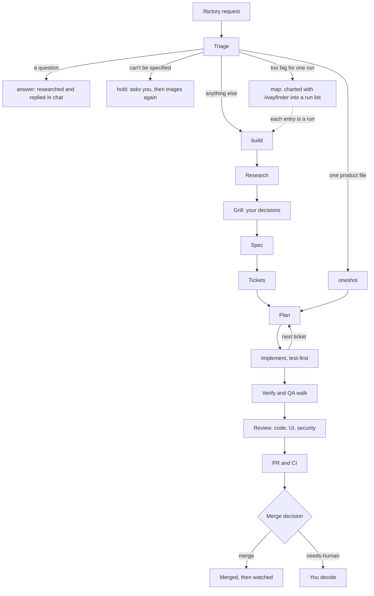

# factory

A Claude Code plugin that carries a one-line request through triage, spec, tickets, implementation, verification, review and PR to a merge decision made from facts.

You type `/factory add a dark mode toggle to settings`. The factory asks you the decisions only you can make, then works on its own until a PR is open: it writes a spec with numbered success criteria, cuts it into tickets, builds each one test-first in its own worktree, runs the project's checks, walks the app, reviews the diff and opens the PR. A script, not an agent, then decides from the recorded facts whether the PR is safe to merge.

## Install

```
/plugin marketplace add thedammyking/factory
/plugin install factory@factory
```

`/plugin install` is the only supported install path. Installing with `npx skills add` is not supported ([#30](https://github.com/thedammyking/factory/issues/30)): it installs skills alone, and the factory also ships agents, a hook and scripts.

To install from a local checkout, pass its path to `/plugin marketplace add` instead.

You need Node 20 or later, a GitHub remote and a signed-in `gh`.

## Set a project up

Run this once in each project, new or existing:

```
/setup-factory
```

It detects the project's apps, checks and settings, runs every command to prove it works, and shows you one proposal. It asks only what it can't detect, and writes `.factory/` only when you approve. Run it again any time to change an answer.

## Commands

| Command | What it does |
| --- | --- |
| `/factory <request>` | Starts a run for the request: plain text, or a reference to an issue on your tracker. |
| `/factory status` | Shows every run and where it is. |
| `/factory resume [run]` | Continues a run that stopped for you, hit the usage limit or lost its session. |
| `/factory abandon [run]` | Ends a run. Its branch is kept. |
| `/factory try <run>` | Lets you try what a run built, on its preview or with the apps started locally. |
| `/factory retro` | Looks back over finished runs and proposes at most three lasting changes. |
| `/wayfinder` | Charts a map for work too big for one run. |
| `/factory map <map> [N]` | Builds a map's run list, or only its entry N. |
| `/factory approve [run] chart\|run\|abandon` | Answers the map gate: chart a map, run the request anyway, or drop it. |

## How a run goes

Triage reads the request and picks a route:



A few things hold on every route:

- **You decide once, up front.** The grill is where the run asks you things. After it, the factory takes the recommended answer wherever one exists and lists each such call on the PR for you to review. It stops only for what it can't settle: a credential, a sign-in, a cap.
- **Each stage is a fresh agent.** Stages talk through files in the run's directory, never through chat, so no stage inherits another's context.
- **Facts are researched, never asked.** You are asked for decisions only.
- **Every run has caps** on rounds, dispatches, minutes and tokens. A run that crosses one stops and asks; only you can lift it.
- **Proof is pinned.** Each success criterion becomes an end-to-end test written by an agent other than the implementer, kept in your repo and rerun on later runs.
- **The merge decision is computed.** It comes out `merge` or `needs-human` from facts such as check results and open findings. In `trial` mode, the default, the factory only says what it would do. Switching to `auto`, where it merges and then watches the target branch, is yours to do once the trial record earns it.

## Optional integrations

Each has a fallback, and setup offers only the ones it finds connected.

| For | Uses | Otherwise |
| --- | --- | --- |
| Request issues and maps | GitHub Issues, Linear, or a tracker you describe | Local files under `.factory/` |
| Sharing approved specs | Notion | Specs stay in the repo |
| Design sources at plan time | Figma, Mobbin | None |
| Walking the app | Playwright (web), Maestro (mobile) | No walk, and the merge decision is `needs-human` |

## Status

The factory is at 0.2.0 and young. Web projects have had the most use; the mobile path (iOS simulator with Maestro) and hosted previews have had less. New projects start in `trial` merge mode for that reason.

## Learn more

- [GLOSSARY.md](GLOSSARY.md) defines every term used here: run, route, grill, lens, merge decision and the rest.
- [docs/design/design.md](docs/design/design.md) is the full design, and [docs/design/brief.md](docs/design/brief.md) the requirements behind it.
- [docs/platform-facts.md](docs/platform-facts.md) records the Claude Code behaviour the factory relies on, each fact checked with a probe.
- [docs/adr/](docs/adr/) holds the decisions that would be hard to reverse.

## Working on the factory

- `plugin/` is what installs into a project.
- `test/` holds the `node:test` suites; run them with `node --test` (Node ≥ 20). They never ship. A test named `fix N` or `design fix N` is the regression case for fix N in the two fixes tables of [docs/design/design.md](docs/design/design.md).
- `evals/` holds the `claude plugin eval` cases for the agent prompts, run before a tag; see [evals/README.md](evals/README.md). They never ship.

Issues live in [GitHub Issues](https://github.com/thedammyking/factory/issues).

## Licence

MIT, see [LICENSE](LICENSE). Third-party sources are listed in [plugin/THIRD_PARTY_NOTICES.md](plugin/THIRD_PARTY_NOTICES.md).
